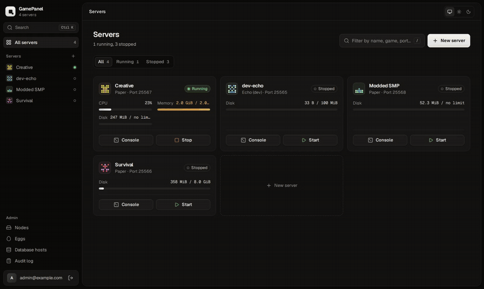
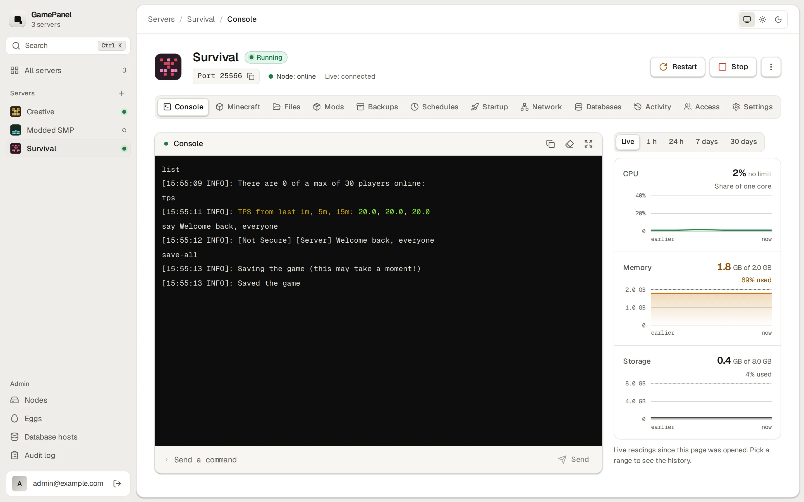
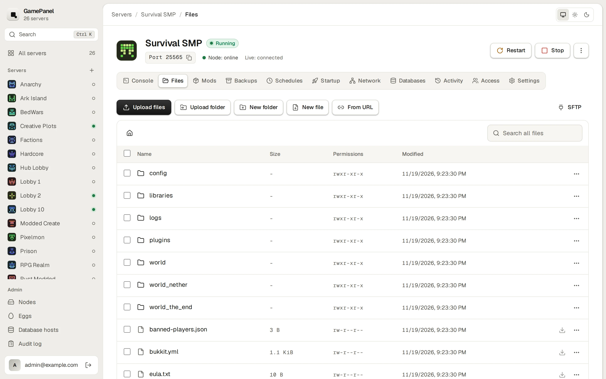
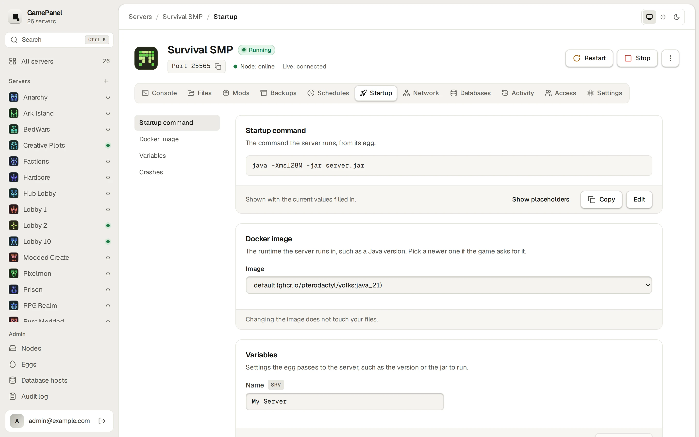
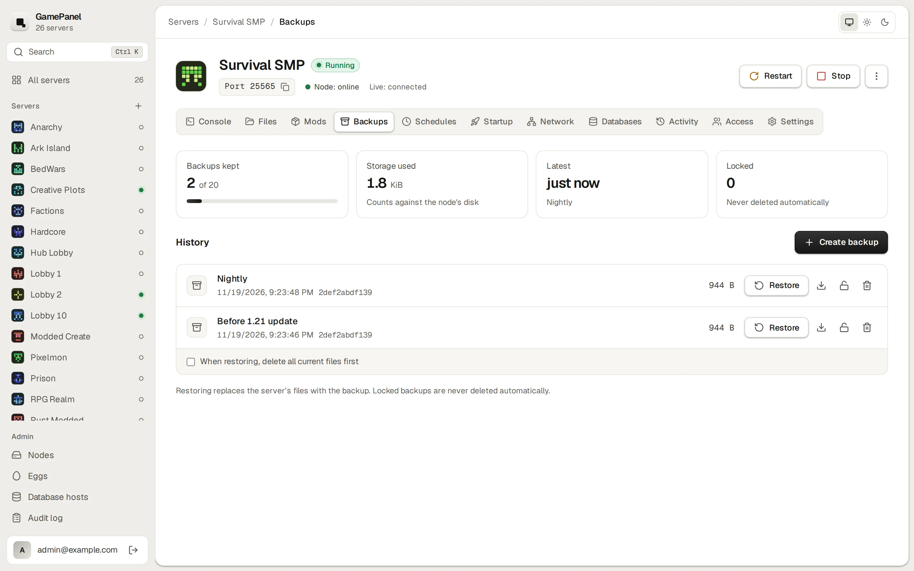
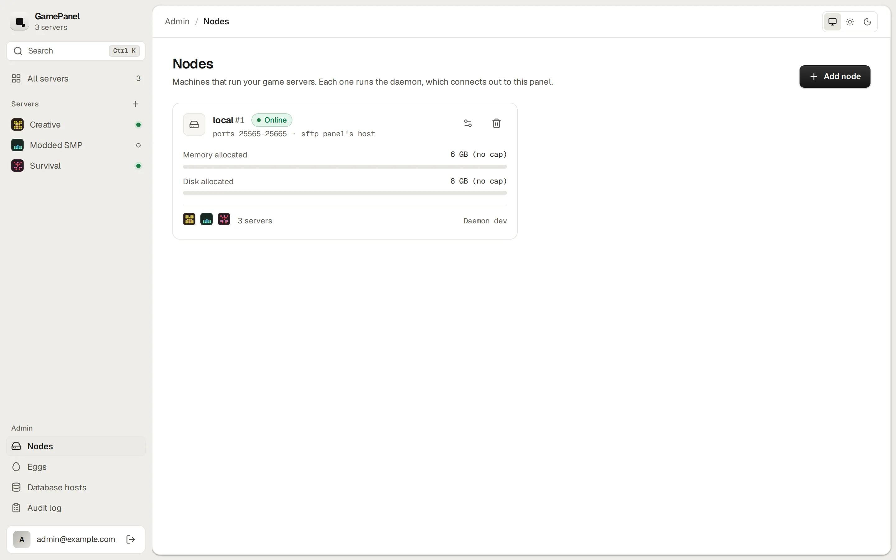
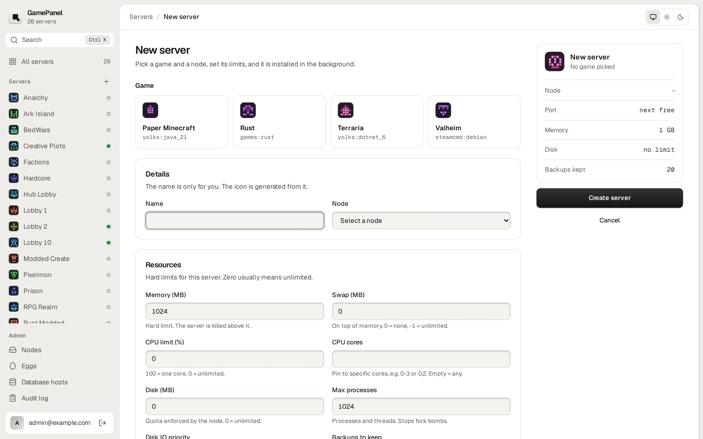
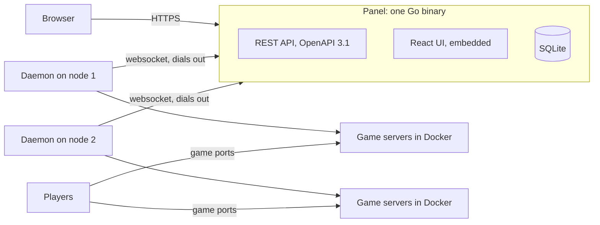

<p align="center">
  <picture>
    <source media="(prefers-color-scheme: dark)" srcset="docs/public/logo.svg">
    
  </picture>
</p>

<h1 align="center">GamePanel</h1>

<p align="center"><b>A game server panel that is small, secure by default, and runs your Pterodactyl eggs unchanged.</b></p>

<p align="center">
  <a href="https://github.com/ZsombiiHUN/gamepanel/releases/latest"></a>
  <a href="https://github.com/ZsombiiHUN/gamepanel/stargazers"></a>
  <a href="https://github.com/ZsombiiHUN/gamepanel/actions/workflows/ci.yml"></a>
  <a href="LICENSE"></a>
  
  
</p>
<p align="center">
  <a href="https://zsombiihun.github.io/gamepanel/"></a>
  <a href="https://github.com/ZsombiiHUN/gamepanel/pkgs/container/gamepanel"></a>
  <a href="https://github.com/ZsombiiHUN/gamepanel/discussions"></a>
  <a href="https://scorecard.dev/viewer/?uri=github.com/ZsombiiHUN/gamepanel"></a>
</p>

<p align="center">
  <a href="https://zsombiihun.github.io/gamepanel/"><b>Documentation</b></a> ·
  <a href="#install"><b>Install</b></a> ·
  <a href="#try-it-from-source"><b>Try it</b></a> ·
  <a href="https://zsombiihun.github.io/gamepanel/guides/compare"><b>Compare</b></a> ·
  <a href="https://github.com/ZsombiiHUN/gamepanel/discussions"><b>Discussions</b></a> ·
  <a href="https://github.com/ZsombiiHUN/gamepanel/issues/new/choose"><b>Report a bug</b></a>
</p>

<p align="center">
  <a href="docs/public/demo/gamepanel-demo.mp4"></a>
</p>

GamePanel has two parts. The **panel** is one Go binary that serves the API and the web UI. The **daemon** runs on each machine that hosts servers and drives Docker. You manage everything from the browser: start and stop servers, watch the console, edit files, take backups, and share access.

It is a simpler, stricter alternative to [Pterodactyl](https://github.com/pterodactyl/panel) and Pelican. It reads their egg files as they are, so the games you already run keep working. See [how it compares](https://zsombiihun.github.io/gamepanel/guides/compare), including where it is still behind.

> [!WARNING]
> **Pre-alpha.** It works end to end and is well tested, but it has not been run in production and the API may change. Read [Status](#status) before you trust it with anything you care about.

> [!TIP]
> **Like where this is going?** Give it a ⭐ at the top of the page. Stars are how other people find a new project, and they tell me what to keep working on. Trying it and [saying what broke](https://github.com/ZsombiiHUN/gamepanel/issues/new/choose) helps even more.

## Why GamePanel

- **One binary, one SQLite file.** No PHP, no Redis, no queue workers. Back up one database and one key file.
- **Eggs import unchanged.** Pterodactyl PTDL v1 and v2 eggs, including install scripts and config file rules, work as they are.
- **Moves a Pterodactyl panel in one go.** Accounts keep their passwords, servers keep their UUIDs, ports and files. See [Coming from Pterodactyl](https://zsombiihun.github.io/gamepanel/guides/from-pterodactyl).
- **The daemon dials out.** Each node opens one websocket to the panel, so a node needs no inbound control port. Uploads and downloads stream through the panel on a separate connection the node also opens itself.
- **Safe where it matters.** File access goes through `os.Root` and is tested against hostile symlinks (the class of bug behind the Wings CVEs). Egg variables never reach a shell. Containers drop all capabilities.
- **Light and dark.** Follows your system, or pick one; both themes pass the same accessibility checks.
- **Fast to use.** Press `Ctrl K` to jump to any server or page. Filters and folders live in the URL, so you can link to them and Back works.
- **Tested against a real browser.** Go tests, component tests and a Playwright suite (with accessibility scans at three screen sizes) run on every change.

## What can it run?

- **Minecraft, with extra care.** GamePanel ships its own eggs for Paper, Purpur, Folia, Vanilla, Fabric, Forge, NeoForge, Velocity and BungeeCord, on Java 8 to 25. They size the JVM to fit the container, write the port before every start, and check every download against its published checksum. See [Minecraft eggs](https://zsombiihun.github.io/gamepanel/admin/minecraft-eggs).
- **Anything with a Pterodactyl egg.** The [pelican-eggs](https://github.com/pelican-eggs) library covers Steam games (Rust, ARK, Valheim and many more), plus applications, bots and databases. Eggs that pass the port on the command line work as they are, and eggs that write it into a config file (`config.files`) get it written before each start, as in Pterodactyl.

## Features

| | |
|---|---|
| **Servers** | Power controls, live console with command input, CPU, memory and disk charts with 30 days of history, per-server limits (memory, swap, CPU, cores, disk quota, processes, IO priority, network bandwidth, backups) |
| **Files** | Browse, edit, search every subfolder; upload files and whole folders by drag and drop, download, rename, move, copy, change permissions, compress and extract (zip, tar.gz, tar.bz2), pull from a URL, act on many files at once; SFTP |
| **Mods** | Search Modrinth for mods, plugins and datapacks (filtered by loader and game version, preset from the egg) and install with one click. Only files from Modrinth's CDN, checked against Modrinth's SHA-512 before they are kept |
| **Startup** | Change the egg's variables (checked against its rules), pick another of its Docker images, and, as an admin, set a custom image or startup command. Changes to a running server apply at its next start |
| **Network** | Several ports per server, each with a note; switch the primary port. Admins set how many extra ports an owner may add |
| **Databases** | MySQL/MariaDB databases per server, each with its own user that can reach only that database; show, copy and rotate passwords. Admins register database hosts (tested before they are saved) and set a per-server limit |
| **Backups** | Create, lock, delete, restore and download; keep them on the node or in any S3-compatible store (AWS, R2, B2, Wasabi, MinIO) without giving nodes the credentials |
| **Schedules** | Cron-style tasks per server |
| **Access** | Subusers with per-server permissions; non-owners get a 404 for servers they can't see |
| **Activity** | Each server's history in plain words (who restarted it, uploaded what, changed which setting), searchable; addresses shown only to the owner |
| **Invitations** | Owners add people by email; anyone without an account gets an invitation (emailed, or a link to pass on) and the server access comes with it. Admins can invite new accounts. Optional open sign-up |
| **Passkeys** | Sign in with a fingerprint, face or device PIN, no password and no second factor needed; phishing-resistant. Copied keys (a signature counter that goes backwards) are refused |
| **Single sign-on** | GitHub, Discord and any OpenID Connect provider (Google, Microsoft, Authentik, Keycloak...), with PKCE. Identities are linked from the account page, never matched by email; two-factor still applies |
| **Accounts** | Password reset by email (or `panel reset-link` without email), Argon2id passwords checked against leaked-password lists, TOTP two-factor with recovery codes and a lockout that survives restarts, API keys, rate-limited login, idle and absolute session timeouts. Each control is mapped to its OWASP ASVS 5.0.0 requirement and test, with the known gaps, in [`docs/asvs.md`](docs/asvs.md) |
| **Admin** | Nodes with capacity tracking, eggs, an audit log you can search |
| **API** | Everything the UI does goes through a documented OpenAPI 3.1 API ([`web/openapi.json`](web/openapi.json)) |
| **Pterodactyl client API** | `/api/client` answers like Pterodactyl's for account, server list and details, resources, power, commands, files and backups, so bots and apps made for Pterodactyl work with a GamePanel API key |

## Screenshots

<table>
  <tr>
    <td width="50%"><picture><source media="(prefers-color-scheme: dark)" srcset="docs/public/screenshots/console-dark.webp"></picture></td>
    <td width="50%"><picture><source media="(prefers-color-scheme: dark)" srcset="docs/public/screenshots/files-dark.webp"></picture></td>
  </tr>
  <tr>
    <td align="center"><sub>Console and live charts</sub></td>
    <td align="center"><sub>Files</sub></td>
  </tr>
  <tr>
    <td width="50%"><picture><source media="(prefers-color-scheme: dark)" srcset="docs/public/screenshots/startup-dark.webp"></picture></td>
    <td width="50%"><picture><source media="(prefers-color-scheme: dark)" srcset="docs/public/screenshots/backups-dark.webp"></picture></td>
  </tr>
  <tr>
    <td align="center"><sub>Startup variables</sub></td>
    <td align="center"><sub>Backups</sub></td>
  </tr>
  <tr>
    <td width="50%"><picture><source media="(prefers-color-scheme: dark)" srcset="docs/public/screenshots/nodes-dark.webp"></picture></td>
    <td width="50%"><picture><source media="(prefers-color-scheme: dark)" srcset="docs/public/screenshots/new-dark.webp"></picture></td>
  </tr>
  <tr>
    <td align="center"><sub>Nodes</sub></td>
    <td align="center"><sub>New server</sub></td>
  </tr>
</table>

<p align="center"><sub>Every page follows your system theme, so GitHub shows you the light or dark version to match.</sub></p>

## Install

On a Linux server with systemd, one command asks what to install (the panel, a node, or both), checks the machine and the domain, and shows the admin's password at the end. Debian and Ubuntu get Caddy for HTTPS too.

```sh
curl -fsSL https://github.com/ZsombiiHUN/gamepanel/releases/latest/download/install.sh | sudo bash
```

Or with no questions, for scripts and cloud-init (`--yes` accepts the [terms](#license) and installs Docker or Caddy when needed):

```sh
# The panel
curl -fsSL https://github.com/ZsombiiHUN/gamepanel/releases/latest/download/install.sh \
  | sudo bash -s -- panel --domain panel.example.com --email you@example.com --yes

# A node (on each machine that runs game servers; the token comes from Nodes → Create node)
curl -fsSL https://github.com/ZsombiiHUN/gamepanel/releases/latest/download/install.sh \
  | sudo bash -s -- node --panel panel.example.com --token <token> --yes
```

Or with containers: [`compose.yml`](compose.yml) runs the panel behind Caddy, plus an optional node ([Docker Compose guide](docs/panel/docker.md)). Release archives for linux amd64 and arm64, with checksums, are on the [releases page](https://github.com/ZsombiiHUN/gamepanel/releases); the step-by-step guide is [Installing the panel](docs/panel/installing.md).

## Try it from source

You need Go, Node 22 with pnpm 10, and Docker for real servers. The steps below use a fake runtime, so you can try the panel without Docker.

```sh
git clone https://github.com/ZsombiiHUN/gamepanel && cd gamepanel
make web build                           # builds the UI, then bin/panel and bin/daemon

export GAMEPANEL_DB=./panel.db
bin/panel create-admin you@example.com   # prints a random password once
bin/panel                                # http://127.0.0.1:8080
```

Sign in, open **Nodes → Create node**, copy the token, and start a daemon:

```sh
# Fake runtime: no containers, good for a first look
GAMEPANEL_NODE_TOKEN=<token> GAMEPANEL_RUNTIME=fake bin/daemon

# Real servers (needs a running Docker daemon)
GAMEPANEL_NODE_TOKEN=<token> bin/daemon
```

Then import a Pterodactyl egg under **Eggs** and choose **New server**.

> [!TIP]
> Locked out of two-factor? Run `bin/panel reset-2fa you@example.com` on the panel host. Forgot a password on a panel without email? `bin/panel reset-link you@example.com` prints a one-time reset link.

## Documentation

The full documentation is at **[zsombiihun.github.io/gamepanel](https://zsombiihun.github.io/gamepanel/)**, built from [`docs/`](docs/): installing the panel and nodes behind HTTPS, every setting, eggs, backups, the API, troubleshooting and the security model. Read it as a site with `cd docs && pnpm install && pnpm dev`. Start with the [introduction](docs/getting-started/introduction.md) or the [production checklist](docs/getting-started/production-checklist.md).

## Configuration

All settings are environment variables. These are the ones most setups touch:

| Variable | What it does |
|---|---|
| `GAMEPANEL_PUBLIC_URL` | The panel's address, e.g. `https://panel.example.com`. Emails, passkeys and single sign-on need it |
| `GAMEPANEL_DB` | SQLite path (default `./panel.db`). The key file `<db>.key` sits next to it: **back up both** |
| `GAMEPANEL_TRUSTED_PROXIES` | Your reverse proxy's IPs, so rate limits and the audit log see real client addresses |
| `GAMEPANEL_SMTP_HOST` and friends | Email for password resets and invitations |
| `GAMEPANEL_REQUIRE_MFA` | `admins` or `all` to require a second factor |
| `GAMEPANEL_NODE_TOKEN`, `GAMEPANEL_PANEL_URL` | On each node: the token from **Nodes → Create node**, and where to reach the panel |

Every setting, with its default, is in [Panel configuration](https://zsombiihun.github.io/gamepanel/panel/configuration) and [Node configuration](https://zsombiihun.github.io/gamepanel/nodes/configuration). For production, run the panel behind a TLS reverse proxy and point each daemon at it with `wss://`.

## How it works



The browser only ever talks to the panel. Each node opens its own connection out to the panel, so nodes need no inbound control port and can sit behind NAT. See [How it works](https://zsombiihun.github.io/gamepanel/getting-started/architecture) for the details.

- **Stack:** Go `net/http` with [huma](https://github.com/danielgtaylor/huma), SQLite ([modernc](https://gitlab.com/cznic/sqlite)) with goose, coder/websocket, Docker through `moby/moby/client`. The UI is React 19, Vite, TanStack Query and Router, Tailwind 4, xterm.js and CodeMirror, embedded with `go:embed`.
- **Eggs:** `{{VAR}}` becomes `${VAR}`, and values reach the process only as environment variables. A variable can never inject shell syntax, and no secret is ever substituted into a script.
- **Containers:** all capabilities dropped, `no-new-privileges`, a PID limit and no swap.
- **Sessions:** opaque cookies (only a hash is stored) that end after 30 minutes idle or 12 hours, `__Host-` prefixed and `Secure` over HTTPS; API answers are never cached; node tokens stored hashed; websocket origin checked.

## Status

- ✅ **Tested on every change.** `make test` runs the Go tests with the race detector, and `make e2e` drives a real browser. Covered: sign-in, two-factor, access control, node enrollment, egg import, creating and deleting servers, power, console streaming, reading, writing and searching files, refusing symlink escapes, backups and restores, schedules, subusers, SFTP, disk quotas, and refusing cross-origin websockets.
- ✅ **Docker runtime** is checked against a real engine by [`scripts/docker-smoke.sh`](scripts/docker-smoke.sh): image pulls, environment, memory, CPU and process limits, dropped capabilities, ports, console input, stats, stop, restart, kill and cleanup.
- ✅ **Server databases** are checked against a real MariaDB (`TestServerDatabases`), including that a database's user cannot reach anything else.
- ✅ **S3 backups** are checked against a real S3-compatible store (`TestS3Backups`), and request signing against AWS's published example.
- ✅ **Network limits** are checked with iperf3 by [`scripts/bandwidth-smoke.sh`](scripts/bandwidth-smoke.sh). At 10 and 100 Mbit/s, both directions hold at about 96% of the limit, including after restarts. They need root, `tc`, `ip` and `nsenter` on the node; see [Network limits](https://zsombiihun.github.io/gamepanel/nodes/network-limits).
- ⚠️ **Not verified:** Windows and macOS Docker hosts, Podman, and bind-mount edge cases.
- 🚧 **Not built yet:** Pterodactyl's console websocket, Postgres, Windows servers, CurseForge.

## Roadmap

These are next, roughly in this order. There are no dates, and the order may change.

- [ ] **Move a server to another node** ([#93](https://github.com/ZsombiiHUN/gamepanel/issues/93))
- [ ] **Pterodactyl's console websocket**, for bots that stream the console ([#89](https://github.com/ZsombiiHUN/gamepanel/issues/89))
- [ ] **CurseForge mods** ([#87](https://github.com/ZsombiiHUN/gamepanel/issues/87))
- [ ] **Translations**: the interface is ready, and it needs translators

Want to help with one? Issues labelled [help wanted](https://github.com/ZsombiiHUN/gamepanel/labels/help%20wanted) and [good first issue](https://github.com/ZsombiiHUN/gamepanel/labels/good%20first%20issue) are open for anyone.

## FAQ

<details>
<summary><b>Can I move over from Pterodactyl or Pelican?</b></summary>

From Pterodactyl, yes, in one go. `panel import-pterodactyl --apply` brings over accounts (with their passwords and two-factor), nodes, eggs, servers, subusers, schedules and databases. On each node, `install.sh node --adopt-wings` takes over the files Wings kept, so every server keeps its UUID, port and world and nothing is reinstalled. Running servers are stopped with their egg's stop command and started again under GamePanel. See [Coming from Pterodactyl](https://zsombiihun.github.io/gamepanel/guides/from-pterodactyl). From Pelican, import your eggs under **Eggs** and move servers over with SFTP.
</details>

<details>
<summary><b>Do my nodes keep running Wings?</b></summary>

No. Each node runs the GamePanel daemon instead, and the daemon takes over Wings' server folders when you switch. It is one binary, it uses Docker like Wings does, and it connects out to the panel, so the node needs no open control port.
</details>

<details>
<summary><b>Why only SQLite?</b></summary>

One panel with one SQLite file handles many nodes and servers, and backing it up means copying two files. The limit is that several panels cannot share one database. Postgres is not built.
</details>

<details>
<summary><b>Will my Pterodactyl bot or app work?</b></summary>

If it uses the REST client API (`/api/client`), it does: give it a GamePanel API key. Billing modules (WHMCS, Paymenter, Blesta) work too, through the application API with an admin's API key; see [Pterodactyl API](https://zsombiihun.github.io/gamepanel/api/pterodactyl). Bots that stream the console over Pterodactyl's websocket ([#89](https://github.com/ZsombiiHUN/gamepanel/issues/89)) do not work yet.
</details>

<details>
<summary><b>Is it ready for production?</b></summary>

Not yet. It is pre-alpha: well tested, but it has not run in production. If you try it with real players, go through the [production checklist](https://zsombiihun.github.io/gamepanel/getting-started/production-checklist) first, and keep backups.
</details>

<details>
<summary><b>Does it run on Windows?</b></summary>

No. The panel and nodes run on Linux, and game servers run in Docker. For Windows game servers, look at Crafty Controller (Minecraft only) or AMP. See [how GamePanel compares](https://zsombiihun.github.io/gamepanel/guides/compare).
</details>

## Development

```sh
make web build   # UI and binaries
make check       # lint, govulncheck, Go tests with a coverage floor, web checks
make e2e         # browser tests (first time: cd web && pnpm e2e:install)
make hooks       # format and lint staged files before each commit
```

[CONTRIBUTING.md](CONTRIBUTING.md) lists the code standards CI enforces, and [`web/README.md`](web/README.md) covers the web app's own commands.

## Community

Questions, setup help and ideas go to [Discussions](https://github.com/ZsombiiHUN/gamepanel/discussions); [Q&A](https://github.com/ZsombiiHUN/gamepanel/discussions/categories/q-a) is the place for "how do I…". Bugs go to [issues](https://github.com/ZsombiiHUN/gamepanel/issues/new/choose).

## Support the project

GamePanel is built by one person in the open. If you want it to exist:

- ⭐ **Star the repo**, so others can find it.
- 🧪 **Try it** on a spare machine and [report what broke](https://github.com/ZsombiiHUN/gamepanel/issues/new/choose), however small.
- 💬 **Tell someone** who runs game servers, or post your setup in [Show and tell](https://github.com/ZsombiiHUN/gamepanel/discussions/categories/show-and-tell).
- 🛠️ **Send a fix.** Issues labelled [good first issue](https://github.com/ZsombiiHUN/gamepanel/labels/good%20first%20issue) are a good start.

## Contributing and security

Pull requests are welcome. Read [CONTRIBUTING.md](CONTRIBUTING.md) first; the short version is one concern per PR, with a test that proves it. Report vulnerabilities privately, as described in [SECURITY.md](SECURITY.md).

## License

[AGPL-3.0](LICENSE). If the AGPL does not fit how you want to use GamePanel,
for example in a closed-source product or a hosted service whose changes you
cannot publish, a commercial license is available: contact
[@ZsombiiHUN](https://github.com/ZsombiiHUN). Contributors sign a
[CLA](CLA.md) so both licenses stay possible.
