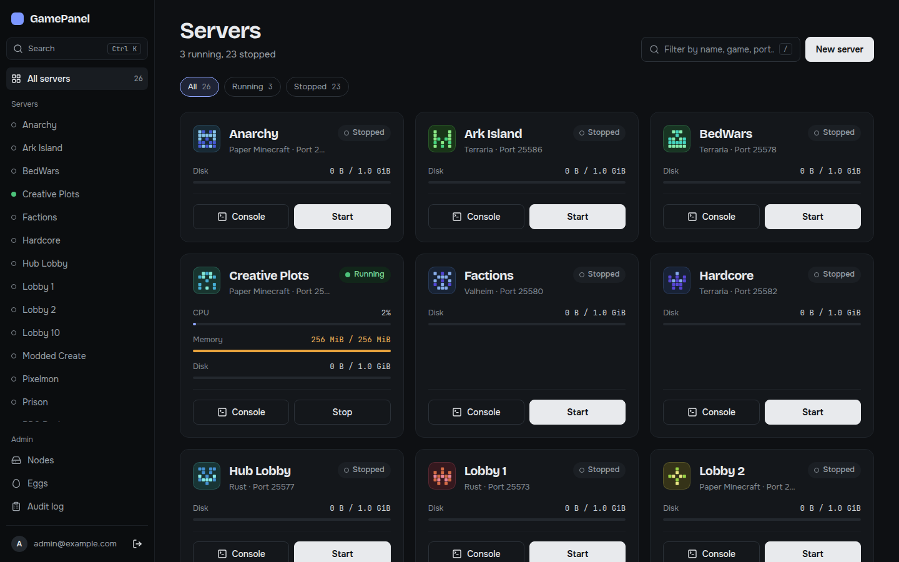
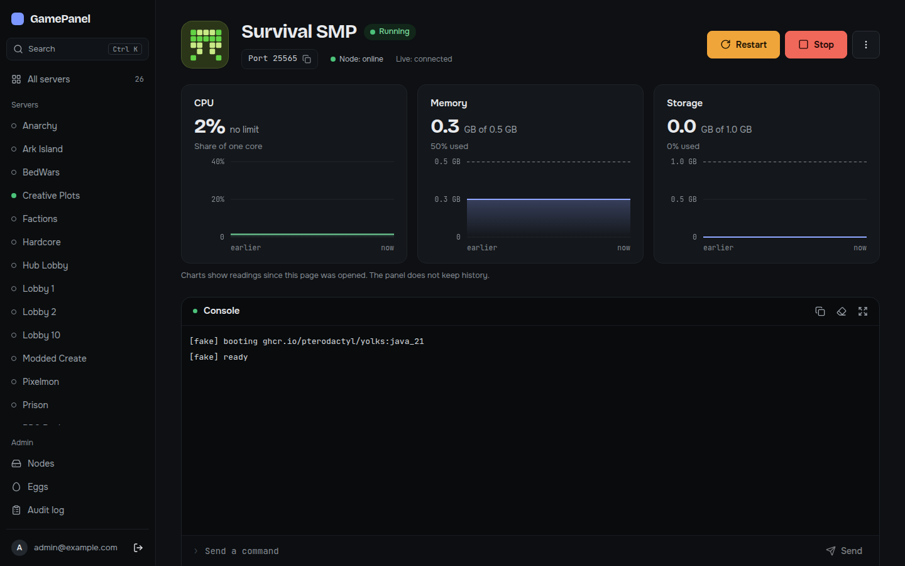

<h1 align="center">GamePanel</h1>

<p align="center"><b>A game server panel that is small, secure by default, and runs your Pterodactyl eggs unchanged.</b></p>

<p align="center">
  <a href="https://github.com/ZsombiiHUN/gamepanel/actions/workflows/ci.yml"></a>
  <a href="LICENSE"></a>
  
  
</p>

<p align="center">
  
</p>

GamePanel has two parts. The **panel** is one Go binary that serves the API and the web UI. The **daemon** runs on each machine that hosts servers and drives Docker. You manage everything from the browser: start and stop servers, watch the console, edit files, take backups, and share access.

It is a simpler, stricter alternative to [Pterodactyl](https://github.com/pterodactyl/panel) and Pelican. It reads their egg files as they are, so the games you already run keep working.

> [!WARNING]
> **Pre-alpha.** It works end to end and is well tested, but it has not been run in production and the API may change. Read [Status](#status) before you trust it with anything you care about.

## Why GamePanel

- **One binary, one SQLite file.** No PHP, no Redis, no queue workers. Back up one database and one key file.
- **Eggs import unchanged.** Pterodactyl PTDL v1 and v2 eggs, including install scripts, work as they are.
- **The daemon dials out.** Each node opens one websocket to the panel, so a node needs no inbound control port. Uploads and downloads stream through the panel on a separate connection the node also opens itself.
- **Safe where it matters.** File access goes through `os.Root` and is tested against hostile symlinks (the class of bug behind the Wings CVEs). Egg variables never reach a shell. Containers drop all capabilities.
- **Light and dark.** Follows your system, or pick one; both themes pass the same accessibility checks.
- **Fast to use.** Press `Ctrl K` to jump to any server or page. Filters and folders live in the URL, so you can link to them and Back works.
- **Tested against a real browser.** Go tests, component tests and a Playwright suite (with accessibility scans at three screen sizes) run on every change.

## Features

| | |
|---|---|
| **Servers** | Power controls, live console with command input, CPU, memory and disk charts with 30 days of history, per-server limits (memory, swap, CPU, cores, disk quota, processes, IO priority, network bandwidth, backups) |
| **Files** | Browse, edit, search every subfolder; upload files and whole folders by drag and drop, download, rename, move, copy, change permissions, compress and extract (zip, tar.gz, tar.bz2), pull from a URL, act on many files at once; SFTP |
| **Mods** | Search Modrinth for mods, plugins and datapacks (filtered by loader and game version, preset from the egg) and install with one click. Only files from Modrinth's CDN, checked against Modrinth's SHA-512 before they are kept |
| **Startup** | Change the egg's variables (checked against its rules), pick another of its Docker images, and, as an admin, set a custom image or startup command. Changes to a running server apply at its next start |
| **Network** | Several ports per server, each with a note; switch the primary port. Admins set how many extra ports an owner may add |
| **Databases** | MySQL/MariaDB databases per server, each with its own user that can reach only that database; show, copy and rotate passwords. Admins register database hosts (tested before they are saved) and set a per-server limit |
| **Backups** | Create, lock, delete, restore and download; keep them on the node or in any S3-compatible store (AWS, R2, B2, Wasabi, MinIO) without giving nodes the credentials |
| **Schedules** | Cron-style tasks per server |
| **Access** | Subusers with per-server permissions; non-owners get a 404 for servers they can't see |
| **Activity** | Each server's history in plain words (who restarted it, uploaded what, changed which setting), searchable; addresses shown only to the owner |
| **Invitations** | Owners add people by email; anyone without an account gets an invitation (emailed, or a link to pass on) and the server access comes with it. Admins can invite new accounts. Optional open sign-up |
| **Passkeys** | Sign in with a fingerprint, face or device PIN, no password and no second factor needed; phishing-resistant. Copied keys (a signature counter that goes backwards) are refused |
| **Single sign-on** | GitHub, Discord and any OpenID Connect provider (Google, Microsoft, Authentik, Keycloak...), with PKCE. Identities are linked from the account page, never matched by email; two-factor still applies |
| **Accounts** | Password reset by email (or `panel reset-link` without email), Argon2id passwords checked against leaked-password lists, TOTP two-factor with recovery codes and a lockout that survives restarts, API keys, rate-limited login, idle and absolute session timeouts. Each control is mapped to its OWASP ASVS 5.0.0 requirement and test, with the known gaps, in [`docs/asvs.md`](docs/asvs.md) |
| **Admin** | Nodes with capacity tracking, eggs, an audit log you can search |
| **API** | Everything the UI does goes through a documented OpenAPI 3.1 API ([`web/openapi.json`](web/openapi.json)) |
| **Pterodactyl client API** | `/api/client` answers like Pterodactyl's for account, server list and details, resources, power, commands, files and backups, so bots and apps made for Pterodactyl work with a GamePanel API key |

<p align="center">
  
</p>

## Quick start

You need Go, Node 22 with pnpm 10, and Docker for real servers. The steps below use a fake runtime, so you can try the panel without Docker.

```sh
git clone https://github.com/ZsombiiHUN/gamepanel && cd gamepanel
make web build                           # builds the UI, then bin/panel and bin/daemon

export GAMEPANEL_DB=./panel.db
bin/panel create-admin you@example.com   # prints a random password once
bin/panel                                # http://127.0.0.1:8080
```

Sign in, open **Nodes → Create node**, copy the token, and start a daemon:

```sh
# Fake runtime: no containers, good for a first look
GAMEPANEL_NODE_TOKEN=<token> GAMEPANEL_RUNTIME=fake bin/daemon

# Real servers (needs a running Docker daemon)
GAMEPANEL_NODE_TOKEN=<token> bin/daemon
```

Then import a Pterodactyl egg under **Eggs** and choose **New server**.

> [!TIP]
> Locked out of two-factor? Run `bin/panel reset-2fa you@example.com` on the panel host. Forgot a password on a panel without email? `bin/panel reset-link you@example.com` prints a one-time reset link.

## Configuration

All settings are environment variables.

**Panel**

| Variable | Default | Description |
|---|---|---|
| `GAMEPANEL_ADDR` | `127.0.0.1:8080` | Listen address |
| `GAMEPANEL_DB` | `./panel.db` | SQLite path |
| `GAMEPANEL_COOKIE_SECURE` | unset | Set to `1` to always treat browsers as on HTTPS. Not needed when HTTPS reaches the panel directly or through a trusted proxy that sends `X-Forwarded-Proto: https`; then the session cookie is `__Host-gp_session`, marked `Secure`, and HSTS is sent |
| `GAMEPANEL_REQUIRE_MFA` | `off` | `admins` or `all`: those accounts must use two factors (authenticator code or passkey). Until they set one up they can only use their account page, and their API keys stop working. An account that has a second factor but signed in without it (password alone with only a passkey, or single sign-on) must sign in again with it |
| `GAMEPANEL_HSTS` | `host` | `subdomains` adds `includeSubDomains` to `Strict-Transport-Security`; `preload` also adds `preload` with a two-year `max-age`. Both affect every subdomain of the panel's domain, so only use them when all of those serve HTTPS |
| `GAMEPANEL_SESSION_IDLE` | `30m` | Sign out a session after this long without use |
| `GAMEPANEL_SESSION_MAX` | `12h` | Sign out a session this long after sign-in, however busy |
| `GAMEPANEL_TRUSTED_PROXIES` | unset | Comma-separated IPs or CIDRs of your reverse proxy. Only then is `X-Forwarded-For` believed, which per-IP rate limits and audit IPs need. The proxy must also keep the `Host` header |
| `GAMEPANEL_PUBLIC_URL` | unset | The panel's address, e.g. `https://panel.example.com`. Links in emails are built from it, never from a request's `Host` header. Passkeys and single sign-on need it too; passkeys need a domain name (or `localhost`), not an IP address |
| `GAMEPANEL_SMTP_HOST` | unset | Send password resets and invitations by email. Needs `GAMEPANEL_PUBLIC_URL` too |
| `GAMEPANEL_SMTP_PORT`, `GAMEPANEL_SMTP_USERNAME`, `GAMEPANEL_SMTP_PASSWORD`, `GAMEPANEL_SMTP_FROM` | 587 | `FROM` like `GamePanel <panel@example.com>` |
| `GAMEPANEL_SMTP_TLS` | `starttls` | `tls` for implicit TLS (port 465), `none` only for a relay on the same machine |
| `GAMEPANEL_SSO_GITHUB_CLIENT_ID`, `GAMEPANEL_SSO_GITHUB_CLIENT_SECRET` | unset | Sign in with GitHub. Callback: `<public url>/api/auth/sso/github/callback` |
| `GAMEPANEL_SSO_DISCORD_CLIENT_ID`, `GAMEPANEL_SSO_DISCORD_CLIENT_SECRET` | unset | Sign in with Discord. Callback: `<public url>/api/auth/sso/discord/callback` |
| `GAMEPANEL_SSO_OIDC_ISSUER`, `GAMEPANEL_SSO_OIDC_CLIENT_ID`, `GAMEPANEL_SSO_OIDC_CLIENT_SECRET`, `GAMEPANEL_SSO_OIDC_NAME` | unset | Any OpenID Connect provider; the name is shown on the button. Callback: `<public url>/api/auth/sso/oidc/callback`. Single sign-on needs `GAMEPANEL_PUBLIC_URL` |
| `GAMEPANEL_SIGNUP` | `invite` | `open` lets anyone make an account; otherwise only invitations do |
| `GAMEPANEL_S3_ENDPOINT` | unset | Store new backups in S3 instead of on the node, e.g. `https://s3.eu-central-1.amazonaws.com`. Nodes only get presigned URLs, never the keys. Backups already on a node stay there |
| `GAMEPANEL_S3_BUCKET`, `GAMEPANEL_S3_ACCESS_KEY`, `GAMEPANEL_S3_SECRET_KEY` | unset | Required with an endpoint |
| `GAMEPANEL_S3_REGION` | `us-east-1` | |
| `GAMEPANEL_S3_PREFIX` | empty | Folder inside the bucket, e.g. `gamepanel/` |
| `GAMEPANEL_S3_PATH_STYLE` | unset | Set to `1` for MinIO and most self-hosted stores (bucket in the path, not the host name) |
| `GAMEPANEL_SECRET_KEY` | key file `<db>.key` | 64 hex characters that encrypt two-factor secrets at rest. If unset, a key file is created next to the database (mode 0600). **Back it up with the database**, or enrolled authenticators cannot be read |

**Daemon**

| Variable | Default | Description |
|---|---|---|
| `GAMEPANEL_NODE_TOKEN` | required | From node creation |
| `GAMEPANEL_PANEL_URL` | `ws://127.0.0.1:8080/daemon/connect` | Where to reach the panel |
| `GAMEPANEL_DATA_DIR` | `./daemon-data` | Server files |
| `GAMEPANEL_RUNTIME` | `docker` | `fake` for development |
| `GAMEPANEL_PULL_ALLOW_PRIVATE` | unset | Set to `1` to let "download from a URL" fetch from private and local addresses. Off by default, so server owners cannot make the node reach its own network |
| `GAMEPANEL_SFTP_ADDR` | `0.0.0.0:2022` | SFTP listener; `off` disables it. Sign in as `<email>.<first 8 characters of the server uuid>` with an **API key** (Account page) as the password. The host key is created in the data dir on first start |

For production, run the panel behind a TLS reverse proxy and point the daemon at it with `wss://`.

## How it works

```
 Browser ──HTTPS──▶  Panel (Go binary)  ◀──websocket──  Daemon ──▶ Docker
                     ├─ REST API (OpenAPI 3.1)          (one per node, dials out)
                     ├─ React UI, embedded
                     └─ SQLite
```

- **Stack:** Go `net/http` with [huma](https://github.com/danielgtaylor/huma), SQLite ([modernc](https://gitlab.com/cznic/sqlite)) with goose, coder/websocket, Docker through `moby/moby/client`. The UI is React 19, Vite, TanStack Query and Router, Tailwind 4, xterm.js and CodeMirror, embedded with `go:embed`.
- **Eggs:** `{{VAR}}` becomes `${VAR}`, and values reach the process only as environment variables. A variable can never inject shell syntax, and no secret is ever substituted into a script.
- **Containers:** all capabilities dropped, `no-new-privileges`, a PID limit and no swap.
- **Sessions:** opaque cookies (only a hash is stored) that end after 30 minutes idle or 12 hours, `__Host-` prefixed and `Secure` over HTTPS; API answers are never cached; node tokens stored hashed; websocket origin checked.

## Status

**Works and is tested** (`make test` runs with the race detector, `make e2e` drives a real browser): auth, two-factor, access control, node enrollment, egg import, server create and delete, power, console streaming, file read, write and search, symlink escape rejection, backups with restore, schedules, subusers, SFTP, disk quotas, and cross-origin websocket rejection.

**Docker runtime** is verified against a real engine by [`scripts/docker-smoke.sh`](scripts/docker-smoke.sh): image pull, env, memory, CPU and PID limits, dropped capabilities, port publishing, console input, stats, stop, restart, kill and cleanup.

**Server databases** are verified against a real MariaDB by `TestServerDatabases` when `GAMEPANEL_TEST_MYSQL` is set, including that a database's user cannot reach anything else.

**S3 backups** are verified against a real S3-compatible store (RustFS) by `TestS3Backups` when `GAMEPANEL_TEST_S3_ENDPOINT` is set, and request signing against AWS's published example.

**Network limits** are applied with `tc` inside the container's network namespace (needs root, `tc` and `nsenter` on the node; if they are missing the server starts unlimited and its console says so). The commands are checked against a real kernel in a network namespace, where shaping measured 10 Mbit/s up and policing under 10 Mbit/s down; they have not yet been run against a real Docker host.

**Not verified:** Windows and macOS Docker hosts, Podman, and bind-mount edge cases.

**Not built yet:** Pterodactyl's application (admin) API and websocket, Postgres, Windows servers, billing, CurseForge.

## Development

```sh
make web build   # UI and binaries
make test        # Go tests, race detector on
make e2e         # browser tests (first time: cd web && pnpm e2e:install)
cd web && pnpm lint && pnpm test
```

[`web/README.md`](web/README.md) lists the checks CI runs.

## Contributing and security

Pull requests are welcome. Read [CONTRIBUTING.md](CONTRIBUTING.md) first; the short version is one concern per PR, with a test that proves it. Report vulnerabilities privately, as described in [SECURITY.md](SECURITY.md).

## License

[AGPL-3.0](LICENSE).
